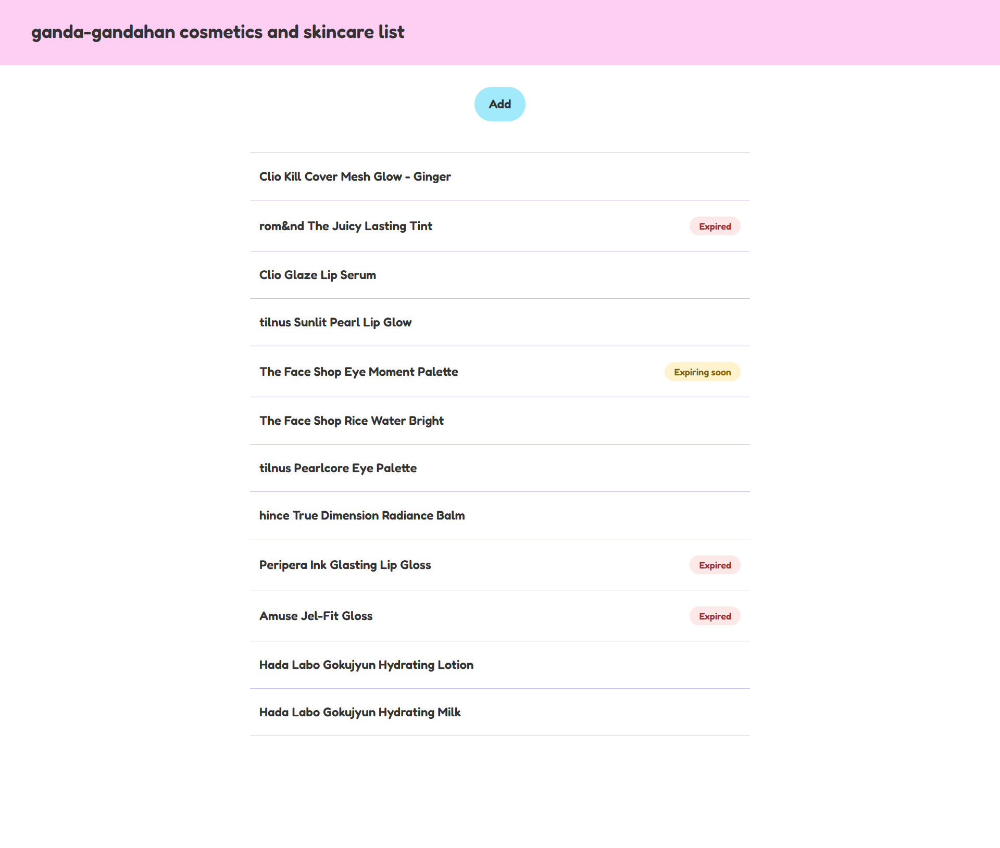

# 🧴 Skincare Inventory

A skincare inventory app built with SvelteKit to keep track of the products I own: what they are, when they expire, and whether I'd buy them again.

**Live demo:** https://ganda-gandahan.vercel.app/



## Features

- Add, edit, and delete skincare products
- Track brand, product type, expiry date, and notes for each product
- Mark a repurchase status: **Buy again**, **Maybe**, or **Stop**
- Search existing brands and product types, or add new ones as I type

**Planned (Phase 2):** a wishlist for products I want to try.

## Tech Stack

- [SvelteKit](https://kit.svelte.dev/) + TypeScript, using Svelte 5 runes
- [Prisma](https://www.prisma.io/) ORM
- [Turso](https://turso.tech/) (libSQL) database
- [Tailwind CSS](https://tailwindcss.com/)
- [Storybook](https://storybook.js.org/) for component development
- Deployed on [Vercel](https://vercel.com/)

## Getting Started

### Prerequisites

- Node.js 20+
- A [Turso](https://turso.tech/) database (or a local SQLite file for development)

### Setup

```bash
git clone https://github.com/chrstnnglc/ganda-gandahan.git
cd ganda-gandahan
npm install
cp .env.example .env
```

Fill in `.env`:

| Variable             | Description                                                                         |
| -------------------- | ----------------------------------------------------------------------------------- |
| `TURSO_DATABASE_URL` | Turso database URL (`libsql://...`). Used when set.                                 |
| `TURSO_AUTH_TOKEN`   | Turso auth token. Not needed for a local file.                                      |
| `LOCAL_DATABASE_URL` | Local SQLite file (e.g. `file:local.db`), used when `TURSO_DATABASE_URL` is not set |

Then apply the schema and start the dev server:

```bash
npx prisma migrate dev
npm run dev
```

Open http://localhost:5173.

### Storybook

```bash
npm run storybook
```

## Project Structure

```
.
├── prisma/
│   ├── migrations/             # Prisma migration history
│   ├── schema.prisma           # Data model (Product, Brand, ProductType)
│   └── seed.ts                 # Seed script
├── src/
│   ├── routes/                 # Pages and form actions
│   │   ├── +layout.svelte
│   │   ├── +page.svelte        # Home
│   │   └── products/
│   │       ├── +page.server.ts # Product list
│   │       ├── add/            # Add a product
│   │       └── [id]/           # Product details
│   │           └── edit/       # Edit a product
│   ├── lib/
│   │   ├── components/         # UI components, one folder each
│   │   │   ├── Button/
│   │   │   ├── ExpiryPill/
│   │   │   ├── Header/
│   │   │   ├── Page/
│   │   │   ├── ProductForm/
│   │   │   └── ProductTable/
│   │   ├── assets/             # Favicon and other static assets
│   │   └── prisma.ts           # Prisma client (libSQL / Turso adapter)
│   ├── stories/                # Storybook docs and assets
│   ├── app.css                 # Global styles (Tailwind)
│   └── app.html
├── static/                     # Files served as-is
├── docs/                       # README screenshots
├── .storybook/                 # Storybook config
├── prisma.config.ts
├── svelte.config.js
├── tailwind.config.js
└── vite.config.ts
```

Each component lives in its own folder, with its `.svelte` and `.stories.svelte` files side by side, and is styled with Tailwind classes.

## Data Model

Defined in [`prisma/schema.prisma`](prisma/schema.prisma):

- `Product`: name, brand, type, optional expiry date, repurchase status (`BUY_AGAIN`, `MAYBE`, `STOP`), notes
- `Brand`: shared across products
- `ProductType`: shared across products
- `WishlistItem`: in the schema for the planned Phase 2 wishlist; not used by the app yet

## Deployment

Deployed on Vercel with a Turso database (SQLite doesn't work on Vercel's serverless runtime, which is why the app uses Turso). Set the environment variables above in the Vercel project settings.

## License

MIT
